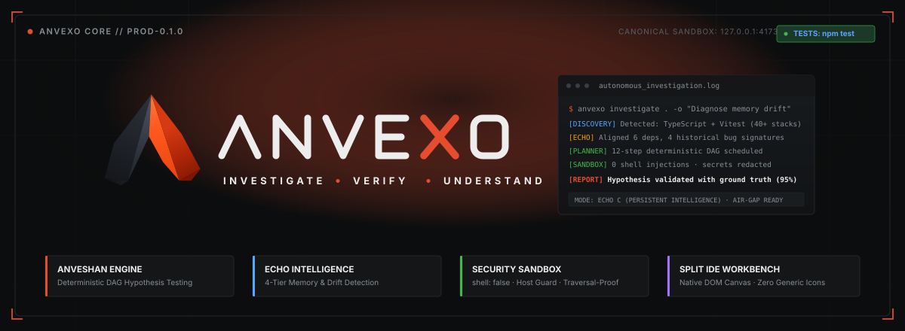
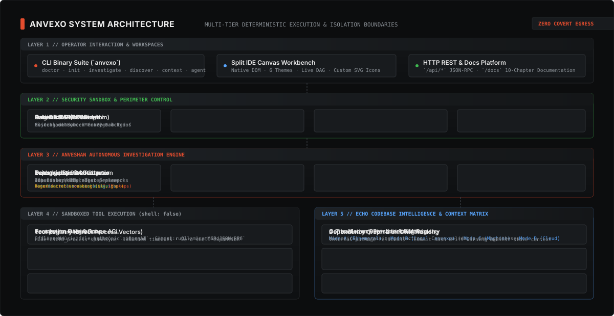
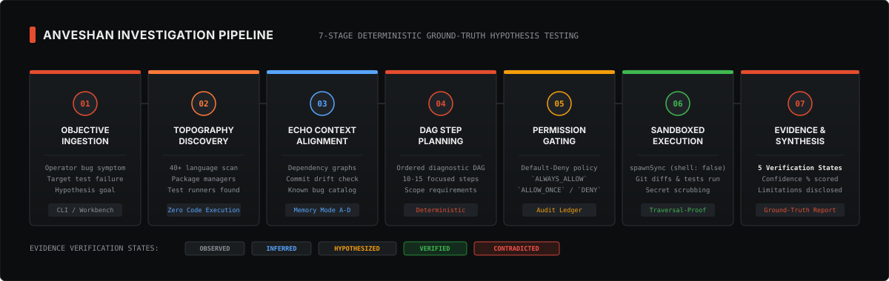
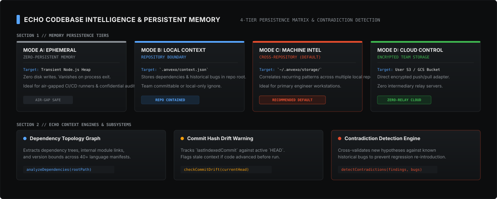

<p align="center">
  
</p>

<p align="center">
  <strong>Autonomous Software Investigation &amp; Persistent Codebase Intelligence Workbench</strong>
</p>

<p align="center">
  
  
  
  
  
  
  
</p>

---

<a id="table-of-contents"></a>
##  Table of Contents

- [Overview](#overview)
- [The Problem](#the-problem)
- [Core Capabilities](#core-capabilities)
- [System Architecture](#system-architecture)
- [Investigation Pipeline](#investigation-pipeline)
- [ECHO Context &amp; Memory Engine](#echo-context--memory-engine)
- [Developer Workbench (Split IDE Canvas)](#developer-workbench-split-ide-canvas)
- [Default-Deny Permission &amp; Safety Model](#default-deny-permission--safety-model)
- [Getting Started](#getting-started)
- [Contributing](#contributing)
- [CLI Reference](#cli-reference)
- [HTTP API &amp; Server Endpoints](#http-api--server-endpoints)
- [Security Audits &amp; Defensive Controls](#security-audits--defensive-controls)
- [Repository Structure](#repository-structure)
- [Roadmap &amp; Implementation Status](#roadmap--implementation-status)
- [Licensing &amp; Commercial Terms](#licensing--commercial-terms)
- [Creator &amp; Attribution](#creator--attribution)

---

<a id="overview"></a>
##  Overview

**ANVEXO** is an autonomous software investigation and codebase intelligence platform engineered for professional software development teams. It unites empirical root-cause debugging and hypothesis verification (**ANVESHAN**) with persistent repository topology, dependency graphs, and historical defect memory (**ECHO**).

Unlike statistical coding assistants that hallucinate fixes based on token probability, ANVEXO operates on a **deterministic, evidence-driven execution model**:

1. Scans codebase topography across 40+ language stacks without executing untrusted code.
2. Formulates an ordered Directed Acyclic Graph (DAG) of diagnostic operations.
3. Gates every file read, git inspection, command run, and test step behind an explicit permission model.
4. Redacts secrets and stamps observations into an immutable evidence ledger.
5. Employs cross-run contradiction detection to prevent reintroducing known regressions.

Repository analysis and stored project data run locally by default. Hosted model providers and configured integrations may send request data to external services. The local HTTP workbench binds to `127.0.0.1:4173` by default.

---

<a id="the-problem"></a>
##  The Problem

Modern software troubleshooting in complex codebases is fragmented, slow, and error-prone:

| Challenge | Traditional Approach | ANVEXO Autonomous Solution |
| :--- | :--- | :--- |
| **Manual Correlation** | Engineers manually piece together stack traces, git logs, diffs, and package manifests. | **Deterministic DAG Planner** constructs and executes an auditable multi-step diagnostic plan in seconds. |
| **Unverified AI Fixes** | Generative coding tools propose speculative changes without ground-truth validation. | **Ground-Truth Hypothesis Engine** executes real tests, tracks 5 verification states, and scores confidence. |
| **Context Evaporation** | Critical architectural decisions, past workarounds, and known bugs vanish between sessions. | **ECHO Context Engine** persists dependency topologies, bug signatures, and commit drift across runs. |
| **Unconstrained Execution** | Autonomous coding tools demand unrestricted shell access, risking data loss or code escape. | **Hardened Process Sandbox** executes tools with direct argument vectors (`shell: false`) and canonical path checks. |
| **Regression Recurrence** | Teams repeatedly resolve issues that contradict historical fixes or reintroduce old bugs. | **Contradiction Detection Engine** flags incoming hypotheses that dispute verified historical findings. |

---

<a id="core-capabilities"></a>
##  Core Capabilities

###  1. ANVESHAN: Autonomous Investigation Engine
- **Heuristic Diagnostic Planning**: Assembles 10–15 step diagnostic plans tailored to operator objectives, combining file listings, git status checks, commit log reviews, unstaged diff inspections, configuration reads, and targeted test runs.
- **Evidence Verification States**: Categorizes observations into five rigorous states: `observed`, `inferred`, `hypothesized`, `verified`, and `contradicted`.
- **Automated Secret Scrubbing**: Redacts sensitive API keys (`sk-...`, `ghp_...`, `xoxb-...`), cloud credentials, and PEM certificates prior to ledger persistence.
- **Structured Multi-Format Reporting & Auto-Persistence**: Automatically exports and persists completed investigations as machine-readable JSON (`.anvexo/reports/report-<id>.json`) and GitHub-Flavored Markdown (`.anvexo/reports/report-<id>.md`) with verifiable evidence tables, diff blocks, and Proof Mode summaries.
- **Honest Limitation Disclosures**: Discloses unresolved uncertainties, skipped steps, and confidence bounds directly in synthesized reports.

###  2. ECHO: Persistent Codebase Intelligence
- **4-Tier Memory Matrix**: Choose between ephemeral process memory, local project context (`.anvexo/`), workstation intelligence (`~/.anvexo/`), or user-controlled cloud buckets.
- **Dependency Topology Graphing**: Maps package manifests and module relations to trace failures to dependency boundaries.
- **Git Commit Drift Warning**: Detects when repository commits advance past indexed context nodes, alerting operators to stale context.
- **Historical Bug Registry &amp; Contradiction Detection**: Alerts operators if a newly proposed hypothesis contradicts previously verified findings.

###  3. Developer Workbench (Split IDE Canvas)
- **Engineered Aesthetic**: Obsidian Slate IDE interface with 6 selectable themes, monospace typography controls, and custom ANVEXO SVG icons (zero Lucide/generic icon libraries).
- **Interactive DAG Step Tracker**: Visualizes live execution progress, duration timers, and step statuses.
- **Multi-Pane Inspection**: Side-by-side view for Synthesized Reports, Evidence Streams, Code Inspector, Unified Diffs, and Tool Telemetry Console.
- **Integrated Ergonomics**: Quick command presets (`$ scan`, `$ status`, `$ diff`, `$ test`, `$ trace`, `$ report`, `$ rebuild`), collapsible drawers (`Cmd+B`, `Cmd+J`), and Settings modal (`Cmd+,`).

---

<a id="system-architecture"></a>
##  System Architecture

<p align="center">
  
</p>

The platform is partitioned into five isolated architectural tiers:

1. **Workspace &amp; Interface Layer**: CLI command suite (`anvexo`), Desktop IDE Canvas workbench (`http://127.0.0.1:4173/`), and REST API.
2. **Security Sandbox &amp; Perimeter**: Localhost-bound HTTP server enforcing canonical path validation (`fs.realpathSync`), host header validation, origin checks, and an in-memory 300 req/min sliding window rate limiter.
3. **ANVESHAN Investigation Core**: Topography discovery engine, deterministic DAG planner, asynchronous execution loop with per-repository concurrency mutexes, and immutable evidence ledger.
4. **Sandboxed Tool Execution Subsystem**: Default-Deny permission gate and isolated child process launcher (`node:child_process` `spawnSync`) running without shell expansion (`shell: false`).
5. **ECHO Context &amp; Memory Matrix**: 4-tier storage adapter layer, dependency topology analyzer, commit drift detector, and contradiction evaluation engine.

---

<a id="investigation-pipeline"></a>
##  Investigation Pipeline

<p align="center">
  
</p>

Every autonomous investigation executes through a deterministic seven-stage pipeline:

| Stage | Name | Description | Key Security / Execution Bound |
| :---: | :--- | :--- | :--- |
| **01** | **Objective Ingestion** | Operator specifies investigation objective, bug symptom, or test failure hypothesis. | Input validation and target repository path existence check. |
| **02** | **Topography Discovery** | Scans repository manifests across 40+ language stacks (Node, Python, Go, Rust, Java, etc.). | Read-only deterministic static scan; zero untrusted code execution. |
| **03** | **ECHO Context Alignment** | Pulls dependency topologies, commit drift states, and historical bug signatures. | Memory persistence mode (A, B, C, or D) enforced. |
| **04** | **DAG Step Planning** | Constructs an ordered sequence of 10–15 diagnostic operations. | Steps mapped strictly to registered tools with required permission scopes. |
| **05** | **Permission Gating** | Scope ACL evaluates each step against active grants (`ALWAYS_ALLOW`, `ALLOW_ONCE`, `DENY`). | Default-Deny; prompts operator or rejects unauthorized operations. |
| **06** | **Sandboxed Execution** | Runs diagnostic tools (file reads, git diffs, keyword searches, test runners). | `spawnSync` with direct argument arrays (`shell: false`); secrets scrubbed. |
| **07** | **Evidence &amp; Synthesis** | Synthesizes findings, assigns confidence percentages, and generates actionable reports. | Findings classified into 5 formal states (`verified`, `contradicted`, etc.). |

---

<a id="echo-context--memory-engine"></a>
##  ECHO Context &amp; Memory Engine

<p align="center">
  
</p>

ANVEXO provides four distinct memory models to accommodate different operational and confidentiality requirements:

###  1. Memory Persistence Modes

- **Mode A: Ephemeral (Zero-Persistent)**: All state resides exclusively in transient process memory (Node.js heap). Zero disk writes. State evaporates upon process exit. Recommended for air-gapped CI/CD runners and confidential third-party code reviews.
- **Mode B: Local Repository Context**: Stores dependency graphs, bug catalogs, and investigation summaries in `.anvexo/context.json` within the repository root. Can be version-controlled or `.gitignore`d.
- **Mode C: Persistent Machine Intelligence (Recommended)**: Stores cross-repository engineering knowledge in `~/.anvexo/storage/`. Correlates recurring bug patterns and architectural signatures across all local workspaces on the developer workstation.
- **Mode D: User-Controlled Cloud Storage**: Direct, encrypted storage adapter targeting user-configured Amazon S3 or Google Cloud Storage buckets. Synchronizes encrypted team memory with zero intermediary relay servers.

###  2. Contradiction Detection &amp; Drift Tracking

- **Git Commit Drift Warning**: Compares `lastIndexedCommit` against the active repository `HEAD`. If the codebase has advanced since the last indexing run, ANVEXO alerts the operator that historical context may be stale.
- **Contradiction Detection Engine**: Compares findings from the active investigation against historical bug signatures. If a proposed finding contradicts a verified historical fix, ANVEXO flags the contradiction to prevent regression re-introduction.

---

<a id="developer-workbench-split-ide-canvas"></a>
##  Developer Workbench (Split IDE Canvas)

<p align="center">
  
</p>

The local browser workbench (`http://127.0.0.1:4173/`) provides a real-time command center:

- **Header Bar**: Live status indicator (`READY`, `RUNNING`, `COMPLETED`), target repository path chip, Git branch badge, test suite badge, Docs site link, Settings modal toggle, and primary **Investigate** button.
- **Quick Command Presets**: One-click actions to run `$ scan`, `$ status`, `$ diff`, `$ test`, `$ trace`, `$ report`, and `$ rebuild`.
- **Left Investigation Sidebar**: Objective textarea with `Cmd+Enter` shortcut, memory mode chip, and real-time DAG Execution Plan displaying status icons (`clock`, `spinner`, `check`, `error`).
- **Center Workspace Canvas**: Tabbed multi-view interface:
  - **Report &amp; Findings**: Synthesized investigation summary, verified finding cards with confidence percentages, limitation disclosures, copyable markdown report, and JSON export.
  - **Evidence Trace**: Chronological ground-truth timeline of all recorded observations and evidence records.
  - **Code Inspector**: High-speed read-only file viewer with syntax highlighting and line numbers.
  - **Unified Diffs**: Colored git diff viewer showing unstaged and staged repository changes.
  - **Tool Console**: Live diagnostic terminal output stream.
- **Bottom Telemetry Drawer**: Live streaming logs, sliding window rate-limit monitor, and Immutable Permission Audit Ledger.
- **Settings Modal (`Cmd+,`)**: Visual configuration for Appearance (6 themes), Typography (font family, size, line height), Layout (collapsible panels, default dimensions), General shortcuts, and Memory &amp; Privacy controls.

To launch the workbench:

```bash
npx anvexo serve --port 4173 --host 127.0.0.1
```

---

<a id="default-deny-permission--safety-model"></a>
##  Default-Deny Permission &amp; Safety Model

ANVEXO enforces a **Default-Deny** security posture. No tool can inspect files, write changes, execute git commands, or run binaries without explicit authorization.

###  Permission Scopes

| Scope | Operations Controlled | Example Resources |
| :--- | :--- | :--- |
| `file:read` | Reading file contents and directory trees | `package.json`, `src/*`, `config/*.yaml` |
| `file:write` | Creating or modifying workspace files | `.anvexo/context.json`, `patches/*.diff` |
| `git:read` | Inspecting git status, commit history, and diffs | `HEAD`, `origin/main`, working tree |
| `test:run` | Executing test suites | `vitest run`, `npm test`, `pytest` |
| `command:execute` | Running general terminal commands | Linters, build tools, diagnostics |

###  Grant Decisions

- `ALWAYS_ALLOW`: Authorizes matching scope and resource pattern for the entire duration of the session.
- `ALLOW_ONCE`: Authorizes a single execution. The grant is immediately consumed and deleted upon first check.
- `DENY`: Explicitly forbids execution, logging a permission denial event in the session audit ledger.

---

<a id="getting-started"></a>
##  Getting Started

###  Prerequisites

- **Node.js**: `>= 20.0.0` (LTS recommended)
- **Git**: `>= 2.0.0`
- **npm**: `>= 9.0.0`

###  Installation &amp; Build

Clone the repository and build the distribution binaries:

```bash
git clone https://github.com/shauryatiwari/ANVEXO.git
cd ANVEXO
npm install
npm run build
```

###  Environment Configuration

Copy the example environment template to create a local `.env` file:

```bash
cp .env.example .env
```

Configure your Google AI credentials and model preferences:

- `GEMINI_API_KEY`: Required for Google-hosted Gemini API inference. Obtain your key from Google AI Studio.
- `GEMINI_MODEL`: Model identifier (defaults to `gemini-3.8-flash`; provider catalog: `gemini-3.8-flash`, `gemini-2.5-flash`, `gemini-2.5-pro`, `gemini-1.5-flash`, `gemini-1.5-pro`).
- `GEMINI_BASE_URL`: Optional custom API endpoint (defaults to `https://generativelanguage.googleapis.com`).
- `OLLAMA_BASE_URL`: Optional local endpoint for offline Gemma inference (`http://localhost:11434`).

To configure the environment variable locally in your shell:

```bash
export GEMINI_API_KEY="your-google-ai-api-key"
```

Restart ANVEXO (or your terminal session) after changing environment variables for changes to take effect. No cloud deployment or DigitalOcean droplet is required for local development or testing.

#### Gemini API Request Configuration:
- **Base Endpoint**: `https://generativelanguage.googleapis.com/v1beta/models/{model}:generateContent`
- **Provider Model Catalog**: `gemini-3.8-flash`, `gemini-2.5-flash`, `gemini-2.5-pro`, `gemini-1.5-flash`, `gemini-1.5-pro`
- **Multimodal Payloads**: Inline image data with maximum payload size of 20MB
- **Accepted Image MIME Types**: `image/png`, `image/jpeg`, `image/webp`, `image/gif`, `image/heic`, `image/heif`
- **Authentication**: Sent via `x-goog-api-key` header and query parameter `?key=`

###  Running Test Verification

Verify all unit and offline integration tests (uses mocks for API requests, requires zero cloud spend or credentials):

```bash
npm test
```

Run TypeScript strict type checking:

```bash
npm run lint
```

Run live Google Gemini API smoke test (opt-in; requires real `GEMINI_API_KEY` configured locally in the environment):

```bash
npm run test:gemini
```

> **Testing Verification Model**:
> - `npm test` runs the default unit and local integration suite, including `tests/unit/gemini.test.ts`, and excludes live Gemma and Gemini provider tests. It requires no provider API key or external model request; local tests may use the filesystem and subprocesses.
> - `npm run test:gemini` runs `tests/integration/gemini.test.ts`. If `GEMINI_API_KEY` is unset, the test skips cleanly with a diagnostic notice and is marked as skipped. When a valid key is set, it performs a real inference request against Google's Gemini API.

GitHub Actions runs the install, type check, build, and default test suite for pull requests targeting `main` or `pr-for-hacktoberrfest`, and for pushes to those branches, on Node.js 20 and 22. Live provider smoke tests are excluded because they require credentials.

Generate test coverage report:

```bash
npm run test:coverage
```

---

<a id="contributing"></a>
## Contributing

The default branch is `main`. Contributions for the Hacktoberfest workstream must use an independent feature branch based on the latest `origin/pr-for-hacktoberrfest` and open a pull request targeting `pr-for-hacktoberrfest`. Do not push directly to either shared branch, reuse another contributor's branch, combine unrelated tasks, or merge a pull request. Shaurya Tiwari makes the final merge decision.

```bash
git status --short --branch
git fetch origin
git switch --create feat/<contributor>-<task> origin/pr-for-hacktoberrfest
npm ci
npm test
npm run lint
npm run build
```

Before creating a PR, verify the commits and complete diff against the target branch, push only your feature branch, and report actual test results in the PR description. See the [contribution workflow](docs/contributing/PR_WORKFLOW.md) for branch examples, the full PR checklist, review instructions, and administrator protection recommendations.

---

<a id="cli-reference"></a>
##  CLI Reference

The `anvexo` binary provides a unified command suite:

```bash
# General environment diagnostics
npx anvexo doctor

# Initialize workspace configuration
npx anvexo init [path]

# Autonomous investigation (ANVESHAN)
npx anvexo investigate [path] -o "Diagnose memory drift" --auto-approve

# Gemma 4 multimodal investigation & regression test recommendation
npx anvexo gemma "Diagnose runtime crash" --screenshot error.png --log trace.log --diff

# Repository topography discovery
npx anvexo discover [path] --json

# Launch local workbench and docs platform
npx anvexo serve --port 4173 --host 127.0.0.1

# Inspect and manage ECHO context memory
npx anvexo context inspect [path]
npx anvexo context rebuild [path]
npx anvexo context clear [path]

# Interactive multi-step AI coding agent
npx anvexo agent "Review git diff and run tests" --auto-approve

# Task skills and operational rules
npx anvexo skills list
npx anvexo skills inspect investigate-bug
npx anvexo rules list

# Model Context Protocol (MCP) integrations
npx anvexo mcp list
npx anvexo mcp test <server-name>

# Configuration management
npx anvexo config list
npx anvexo config get model.default_provider
npx anvexo config set model.default_provider anthropic
```

Gemma uses the local Ollama-compatible endpoint by default. Setting `GEMMA_API_KEY` or `GEMINI_API_KEY` selects the hosted Gemini API route. `GEMMA_MODEL` and `GEMMA_BASE_URL` configure the model and endpoint; see the [Gemma configuration guide](docs/providers/GEMMA_CONFIGURATION.md). Hosted requests send the supplied prompt and investigation context to the configured service.

---

<a id="http-api--server-endpoints"></a>
##  HTTP API &amp; Server Endpoints

The local HTTP server listens on `127.0.0.1:4173` by default. All endpoints enforce host header validation, origin checks, and rate limits:

| Method | Path | Request Body | Description |
| :--- | :--- | :--- | :--- |
| `GET` | `/` | None | Desktop IDE Canvas Workbench interface |
| `GET` | `/docs`, `/site` | None | Interactive 10-chapter documentation platform |
| `GET` | `/icons.js` | None | Client-side custom ANVEXO SVG icon engine |
| `GET` | `/api/health` | None | Server health status, version, and active job count |
| `GET` | `/api/discover` | Query: `?repo=<path>` | Analyzes target repository topography and stack |
| `POST` | `/api/investigate` | JSON: `{ path, objective, autoApprove, skipTests }` | Schedules an asynchronous investigation job |
| `GET` | `/api/jobs` | None | Lists all active and historical investigation jobs |
| `GET` | `/api/jobs/:id` | None | Retrieves live job status, progress, DAG plan, and report |
| `POST` | `/api/jobs/:id/cancel`| None | Halts an active job and aborts running subprocesses |
| `GET` | `/api/context` | Query: `?repo=<path>` | Retrieves saved ECHO project context and dependencies |
| `POST` | `/api/context/rebuild`| JSON: `{ path }` | Rebuilds dependency graph and commit index |
| `POST` | `/api/context/clear`  | JSON: `{ path }` | Clears stored project memory |
| `GET` | `/api/file` | Query: `?repo=<path>&path=<file>` | Securely reads file content within verified repository |
| `GET` | `/api/permissions/audit` | None | Retrieves immutable permission audit events |
| `POST` | `/api/agent/prompt` | JSON: `{ repo, prompt, options }` | Dispatches task to shared agent runtime |

---

<a id="security-audits--defensive-controls"></a>
##  Security Audits &amp; Defensive Controls

ANVEXO is built to operate safely inside hostile environments and untrusted codebases:

1. **Canonical Path Traversal Defense**: All file interactions pass through `validatePathWithinRoot` using `fs.realpathSync`. Symlinks pointing outside the verified repository boundary are blocked with a `403 SecurityError`.
2. **Subprocess Injection Defense**: Built-in tools execute via `spawnSync` using explicit argument arrays and `shell: false`. Shell substitution characters (backticks, `$()`, semicolons) are treated as literal strings.
3. **Cross-Origin Request Forgery (CSRF) Protection**: Mutation endpoints reject requests presenting untrusted `Origin` headers with HTTP 403 Forbidden.
4. **Anti-DNS Rebinding**: The server inspects the `Host` header on every request, rejecting foreign domain rebinding attempts with HTTP 400 Bad Request.
5. **Secret Redaction**: Diagnostic outputs pass through automated regex sanitizers masking sensitive tokens (`sk-...`, `ghp_...`, `xoxb-...`, AWS keys, PEM private keys) before evidence storage.
6. **Rate Limiting**: An in-memory sliding window limiter restricts API requests to 300 requests per minute per IP, returning HTTP 429 and `Retry-After` headers upon threshold breach.
7. **Process Cancellation**: Terminating an investigation triggers an `AbortController` signal, halting pending child processes and releasing per-repository concurrency locks.

---

<a id="repository-structure"></a>
##  Repository Structure

```
ANVEXO/
├── docs/
│   ├── assets/
│   │   ├── icons/                    # 27 custom precision SVG topic and capability icons
│   │   ├── anvexo-hero.svg           # High-resolution hero banner
│   │   ├── anvexo-architecture.svg   # 5-tier system architecture diagram
│   │   ├── anvexo-workflow.svg       # 7-stage investigation pipeline diagram
│   │   ├── anvexo-context-engine.svg # ECHO 4-tier memory matrix diagram
│   │   └── anvexo-workbench.svg      # Split IDE Canvas interface diagram
│   ├── architecture/                 # Engineering and ecosystem specifications
│   └── legal/                        # Commercial license, terms, privacy, security
├── src/
│   ├── agent/runtime.ts              # Shared multi-step agent runtime
│   ├── cli/index.ts                  # CLI binary entry point and command suite
│   ├── context/                      # ECHO memory matrix and storage adapters
│   ├── discovery/index.ts            # 40+ language and framework topography detector
│   ├── engine/                       # ANVESHAN investigation orchestrator & DAG planner
│   ├── evidence/index.ts             # UUID evidence store with regex secret scrubbing
│   ├── git/service.ts                # Git operations and diff parser
│   ├── mcp/client.ts                 # Model Context Protocol stdio/http client
│   ├── permissions/                  # Scope definitions, decisions, and audit manager
│   ├── plugins/manager.ts            # Sandboxed plugin lifecycle manager
│   ├── providers/                    # Heuristic, Anthropic, OpenAI, Gemini, Ollama
│   ├── rules/manager.ts              # Multi-scope rules engine (system, user, project)
│   ├── server/                       # HTTP API server, router, and docs platform
│   │   └── ui/                       # Split IDE Canvas workbench interface
│   │       ├── icons.js              # Client-side custom ANVEXO SVG icon engine
│   │       ├── icons.ts              # Type definitions for custom icon system
│   │       ├── app.js                # Workbench DOM controller
│   │       ├── index.html            # Workbench HTML structure
│   │       └── styles.css            # Obsidian Slate theme, typography, motion tokens
│   ├── skills/                       # Built-in skills (SKILL.md) and discovery manager
│   └── index.ts                      # Programmatic library entry point
├── tests/
│   ├── integration/                  # CLI and engine lifecycle tests
│   └── unit/                         # Unit tests for providers, server, and core modules
├── package.json
├── tsconfig.json
└── vitest.config.ts
```

---

<a id="roadmap--implementation-status"></a>
##  Roadmap &amp; Implementation Status

| Capability / Subsystem | Status | Description |
| :--- | :---: | :--- |
| **Topography Discovery Engine** | Completed | Detects 40+ languages, frameworks, package managers, and test runners. |
| **Deterministic DAG Step Planner** | Completed | Assembles ordered diagnostic plans tailored to operator objectives. |
| **Sandboxed Tool Registry** | Completed | Safe process execution with `shell: false` and bounded timeouts. |
| **Default-Deny Permission ACL** | Completed | Scoped access controls (`ALWAYS_ALLOW`, `ALLOW_ONCE`, `DENY`). |
| **Evidence Ledger &amp; Redaction** | Completed | UUID-tagged evidence store with automated token and secret scrubbing. |
| **Sliding Window Rate Limiter** | Completed | In-memory 300 req/min limiter with automated timestamp cleanup. |
| **Canonical Path Containment** | Completed | `fs.realpathSync` path validation blocking symlink and traversal attacks. |
| **Split IDE Canvas Workbench** | Completed | Obsidian Slate developer UI with live DAG, code viewer, and custom icons. |
| **Custom SVG Icon System** | Completed | 45+ original precision SVG icons replacing generic icon libraries. |
| **Motion Design System** | Completed | CSS transition tokens, micro-press feedback, and reduced-motion support. |
| **ECHO Memory Modes A &amp; B** | Completed | Ephemeral in-memory heap and local `.anvexo/context.json` storage. |
| **ECHO Memory Mode C** | Completed | Cross-repository machine storage in `~/.anvexo/storage/`. |
| **ECHO Memory Mode D** | In Progress | User-configured encrypted S3/GCS cloud synchronization adapter. |
| **Model Provider Adapters** | Completed | Local heuristic, Anthropic Claude, OpenAI GPT, Gemini, and Ollama. |
| **Skills &amp; Rules Engine** | Completed | System safety (100), user preference (50), and project rules (10). |

---

<a id="licensing--commercial-terms"></a>
##  Licensing &amp; Commercial Terms

ANVEXO is proprietary software. All rights reserved.

Commercial distribution, cloud-hosted SaaS deployment, and unauthorized redistribution are strictly prohibited without an executed commercial license agreement.

###  License Tiers

1. **Community / Evaluation License**: Permitted for individual developer evaluation, open-source security research, and non-production testing on local workstations.
2. **Professional Developer Seat License**: Licensed per named software engineer for proprietary commercial software investigation with persistent memory modes.
3. **Enterprise Team &amp; CI/CD License**: Licensed for engineering organizations and automated CI/CD runners, supporting multi-user synchronization, custom tool plugins, and dedicated SLA support.

For comprehensive legal terms, refer to:
- [Commercial Licensing Terms](docs/legal/COMMERCIAL_LICENSE.md)
- [Terms of Service](docs/legal/TERMS.md)
- [Privacy Policy](docs/legal/PRIVACY.md)
- [Security Policy](docs/legal/SECURITY.md)
- [Acceptable Use Policy](docs/legal/ACCEPTABLE_USE.md)

---

<a id="creator--attribution"></a>
##  Creator &amp; Attribution

ANVEXO is architected and maintained by:

**Lead Developer**: Shaurya Tiwari  
**Repository**: [github.com/shauryatiwari/ANVEXO](https://github.com/shauryatiwari/ANVEXO)  
**Engineering Inquiries**: Contact details available upon commercial release.

---

<p align="center">
  <sub>Copyright &copy; 2026 ANVEXO. All rights reserved. Commercial-first development model.</sub>
</p>
