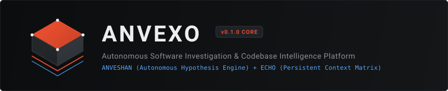
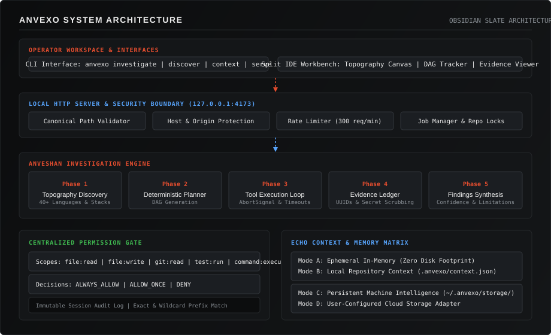
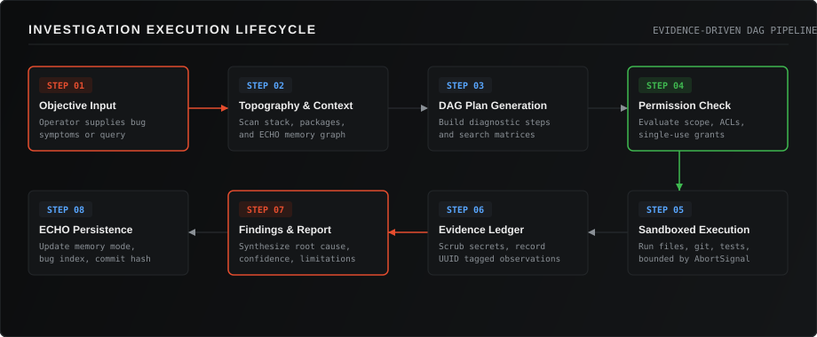
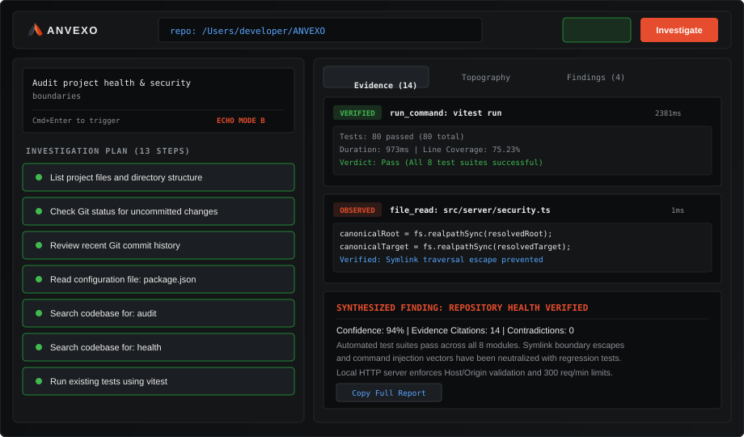
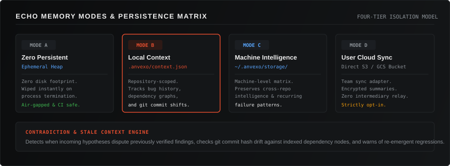

<p align="center">
  
</p>

<p align="center">
  <strong>INVESTIGATE | VERIFY | UNDERSTAND</strong>
</p>

<p align="center">
  
  
  
  
  
  
</p>

---

## Table of Contents

- [Overview](#overview)
- [The Problem](#the-problem)
- [How ANVEXO Works](#how-anvexo-works)
- [Core Capabilities](#core-capabilities)
- [Brand Identity and Visual System](#brand-identity-and-visual-system)
- [System Architecture](#system-architecture)
- [Investigation Lifecycle](#investigation-lifecycle)
- [Developer Workbench (Split IDE Canvas)](#developer-workbench-split-ide-canvas)
- [Permission and Safety Model](#permission-and-safety-model)
- [Memory Modes and Context (ECHO)](#memory-modes-and-context-echo)
- [Technology Stack](#technology-stack)
- [Getting Started](#getting-started)
- [CLI Reference](#cli-reference)
- [API and HTTP Endpoints](#api-and-http-endpoints)
- [Security and Verification](#security-and-verification)
- [Repository Structure](#repository-structure)
- [Roadmap and Implementation Status](#roadmap-and-implementation-status)
- [Licensing and Commercial Terms](#licensing-and-commercial-terms)
- [Creator and Attribution](#creator-and-attribution)

---

## Overview

ANVEXO is an autonomous software investigation and codebase intelligence platform built for professional software engineering teams. It bridges autonomous debugging, hypothesis testing, and root-cause analysis (ANVESHAN) with persistent project intelligence, dependency topology, and historical context tracking (ECHO).

Built on a deterministic, evidence-driven execution model with strict permission gating, ANVEXO replaces ad-hoc guesswork with verifiable diagnostic plans, reproducible evidence ledgers, and honest certainty metrics. It functions locally on your repository with zero covert network egress, preserving confidentiality while delivering deep technical clarity.

---

## The Problem

Modern software debugging is fragmented and error-prone:

1. **Manual Diagnostic Assembly**: Developers spend hours manually correlating application logs, file contents, git commit history, dependency updates, and test outputs to piece together failure modes.
2. **Unverified Coding Assistant Claims**: Conventional AI coding assistants generate code modifications based on statistical likelihood rather than grounded evidence, frequently hallucinating root causes without validating assumptions against real test executions.
3. **Context Evaporation**: Critical engineering context (why a workaround exists, which dependencies trigger specific bugs, past architectural trade-offs) is lost between development sessions.
4. **Unconstrained Tool Access**: Autonomous developer tools often demand unrestricted shell and filesystem permissions, creating severe risks of accidental data destruction, secret exposure, or path traversal.
5. **Regression Recurrence**: Teams repeatedly resolve defects that contradict past architectural fixes because incoming solutions are not checked against historical bug registries.

ANVEXO addresses these challenges by making software investigation an auditable, evidence-backed engineering discipline.

---

## How ANVEXO Works

ANVEXO executes investigations in structured, deterministic stages:

1. **Topography Discovery**: Scans repository structure, configuration files, and package manifests across 40+ programming languages and frameworks without executing untrusted binaries.
2. **Context Matrix Alignment**: Loads historical investigations, dependency graphs, and known bug signatures from the ECHO memory subsystem.
3. **Deterministic Step Planning**: Builds a targeted Directed Acyclic Graph (DAG) of diagnostic operations tailored to the operator objective.
4. **Permission-Gated Tool Execution**: Evaluates every tool invocation against an explicit scope-based permission model. Disallowed actions are rejected or prompted before execution.
5. **Secret Redaction and Evidence Collection**: Scrubs API keys and private tokens from diagnostic outputs, stamping each observation into an immutable evidence ledger with verification states.
6. **Hypothesis Evaluation and Contradiction Detection**: Cross-references collected evidence against hypotheses and alerts the operator if current findings contradict historical fixes.
7. **Synthesis and Structured Reporting**: Produces comprehensive audit reports with confidence metrics, evidence citations, and honest technical limitations.

---

## Core Capabilities

### 1. ANVESHAN: Autonomous Investigation Engine
- **Heuristic Diagnostic Planning**: Constructs ordered multi-step plans combining file listings, git status checks, commit log reviews, unstaged diff inspections, configuration reads, keyword searches, and test executions.
- **Sandboxed Tool Subsystem**: Executes tools through direct argument vectors without shell evaluation (`shell: false`), neutralizing command injection risks.
- **Evidence Verification States**: Tracks observations across five formal states: `observed`, `inferred`, `hypothesized`, `verified`, and `contradicted`.
- **Honest Limitation Disclosures**: Discloses unresolved uncertainties, skipped steps, and unverified assumptions directly in final reports.

### 2. ECHO: Persistent Codebase Intelligence
- **Dependency Topology Graphing**: Maps project dependencies and internal package references to correlate failures with package version boundaries.
- **Git Commit Hash Drift Tracking**: Detects when repository commits advance past indexed context nodes, flagging stale intelligence before planning begins.
- **Historical Bug Knowledge Base**: Records verified defect signatures, root causes, and affected source files across investigation runs.
- **Contradiction Detection Engine**: Flags incoming hypotheses that dispute previously verified findings or risk reintroducing fixed regressions.

### 3. Split IDE Canvas Workbench
- **Multiple Developer Themes**: Ships with 6 engineered themes including Obsidian Slate (default), Midnight Graphite, Nord, Solarized Dark, Light Studio, and High Contrast.
- **Typography and Editor Controls**: Selectable font families (JetBrains Mono, IBM Plex Mono, Fira Code, Inter, system monospace), font sizes (11-18px), line height, and line numbers.
- **Interactive DAG Step Tracker**: Displays real-time progress, execution durations, and step completion statuses.
- **Evidence Stream and Code Viewer**: Provides side-by-side inspection of live diagnostic outputs, git diffs, and repository source code.
- **Layout and Shortcuts**: Draggable split canvas dividers, collapsible sidebar (`Cmd+B`), telemetry drawer (`Cmd+J`), and dedicated Settings modal (`Cmd+,`).
- **Report Aggregation**: One-click markdown report export with complete evidence citations.

---

## Brand Identity and Visual System

The ANVEXO brand language reflects precision, technical authority, and empirical investigation. Engineered to sit alongside modern developer environments such as JetBrains, VS Code, and Zed, the visual system centers on a faceted geometric A-mark, custom uppercase typography with an orange accent on the letter X, and the core engineering principle: **INVESTIGATE | VERIFY | UNDERSTAND**.

### Symbol Anatomy and Geometry

- **Left Facet (Graphite/Charcoal)**: Multi-tonal shaded graphite (`#2D323A` to `#14161A`) representing empirical foundation, codebase memory, and rigor.
- **Right Facet (Vivid Orange)**: High-energy radiant orange (`#FF7A38` to `#E84410`) symbolizing hypothesis testing, active investigation, and discovery.
- **Negative Space**: Balanced interior silhouette maintaining clear readability down to 16x16 icon sizes.
- **Pure Vector Artwork**: 100% SVG geometry with zero raster embeddings, zero artificial 3D bevels, and zero gratuitous neon glows.

### Asset Set and Variants

| Asset | Variant | Context and Resolution | Relative Path |
| :--- | :--- | :--- | :--- |
| **Primary Logo** | Dark Lockup | Documentation, website headers, application splash | `assets/brand/anvexo-logo.svg` |
| **Horizontal Logo** | No Tagline | Compact toolbars, navigation bars, top-level headers | `assets/brand/anvexo-logo-horizontal.svg` |
| **Faceted Symbol** | Standalone Mark | Window title bar, tab chips, status indicators | `assets/brand/anvexo-symbol.svg` |
| **Stacked Logo** | Centered Layout | Constrained square containers, social cards | `assets/brand/anvexo-logo-stacked.svg` |
| **Dark Theme Logo** | High Contrast Dark | Obsidian Slate, Midnight Graphite, Nord themes | `assets/brand/anvexo-logo-dark.svg` |
| **Light Theme Logo** | Charcoal on Light | Light Studio, documentation light theme, print | `assets/brand/anvexo-logo-light.svg` |
| **Monochrome Light** | Solid White / Zinc | High-contrast dark backgrounds, monochrome displays | `assets/brand/anvexo-logo-monochrome-light.svg` |
| **Monochrome Dark** | Solid Slate / Black | High-contrast light backgrounds, monochrome printing | `assets/brand/anvexo-logo-monochrome-dark.svg` |
| **Wordmark Only** | Dark Background | Headers, compact navigation, minimal title bars | `assets/brand/anvexo-wordmark-dark.svg` |
| **Wordmark Only** | Light Background | Light surface documentation and headers | `assets/brand/anvexo-wordmark-light.svg` |
| **Application Icon** | Rounded Squircle | macOS Dock, Windows taskbar, application launchers | `assets/brand/anvexo-app-icon.svg` |
| **Favicon** | 32x32 Vector Mark | Browser tabs, web bookmarks, workbench interface | `assets/brand/favicon.svg` |

---

## System Architecture

<p align="center">
  
</p>

The platform is structured into five isolated layers:

1. **Workspace and Interface Layer**: CLI commands and the local Split IDE Canvas workbench.
2. **HTTP Server and Security Boundary**: Localhost-bound server (`127.0.0.1:4173`) enforcing canonical path validation, host header validation, origin checks, sliding window rate limits, and per-repository mutual exclusion locks.
3. **Core Investigation Orchestrator**: Manages topography discovery, DAG plan generation, asynchronous tool execution loops, evidence collection, and finding synthesis.
4. **Sandboxed Tool Registry**: Enforces safe process execution with bounded timeouts and zero shell metacharacter expansion.
5. **Permission and Memory Boundaries**: Scope-based authorization gate backed by the ECHO four-tier persistence matrix.

---

## Investigation Lifecycle

<p align="center">
  
</p>

Every investigation transitions through an explicit eight-step pipeline:

```
[Objective Input]
       │
       ▼
[Topography & Context Discovery]
       │
       ▼
[DAG Plan Generation]
       │
       ▼
[Permission Gate Evaluation] ──(Denied)──► [Skip / Terminate Step]
       │ (Approved)
       ▼
[Sandboxed Tool Execution]
       │
       ▼
[Secret Redaction & Evidence Ledger]
       │
       ▼
[Findings Synthesis & Confidence Scoring]
       │
       ▼
[ECHO Persistence & Memory Sync]
```

---

## Developer Workbench (Split IDE Canvas)

<p align="center">
  
</p>

The local workbench interface provides real-time visibility into engine operations:

- **Target Header**: Displays active repository path, live connection status dot (`READY`, `RUNNING`, `COMPLETED`), process cancellation trigger, and investigation launcher.
- **Left Control Pane**: Houses the objective prompt box and real-time DAG plan tracker showing completed, running, and pending diagnostic steps.
- **Right Evidence Pane**: Features tabbed views for the Live Evidence Stream (with execution durations and verification badges), Topography & File Viewer, and Synthesized Findings with direct report export.

To launch the workbench locally:

```bash
node dist/cli/index.js serve --port 4173 --host 127.0.0.1
```

Then open `http://127.0.0.1:4173` in your browser.

---

## Permission and Safety Model

ANVEXO operates under a strict Default-Deny permission architecture. Tools cannot touch the filesystem, execute commands, or access git history without authorized grants.

### Permission Scopes

| Scope | Operations Controlled | Example Resources |
| :--- | :--- | :--- |
| `file:read` | Inspecting file contents and listing directories | `package.json`, `src/*`, `config/*.yaml` |
| `file:write` | Creating or modifying workspace files | `.anvexo/context.json`, `patches/*.diff` |
| `git:read` | Inspecting git status, commit logs, and diffs | `HEAD`, `origin/main`, working tree |
| `test:run` | Executing verified test runners | `vitest run`, `npm test`, `pytest` |
| `command:execute` | Running general terminal commands | Diagnostic shell tools, linter binaries |

### Grant Decisions

- `ALWAYS_ALLOW`: Grants persistent authorization for the scope and resource pattern across the entire session.
- `ALLOW_ONCE`: Authorizes a single execution. The grant is immediately consumed and deleted upon first check.
- `DENY`: Explicitly forbids execution, logging a permission denial in the session audit log.

### Pattern Matching

Grants support exact matching (`src/index.ts`), directory wildcard matching (`src/*`), and global wildcards (`*`). Wildcard single-use grants consume the matching wildcard rule on first invocation, preventing accidental privilege persistence.

---

## Memory Modes and Context (ECHO)

<p align="center">
  
</p>

ANVEXO provides four distinct memory models to support diverse confidentiality requirements:

### Mode A: Zero Persistent (Ephemeral)
- **Storage Target**: Transient process memory (Node.js heap).
- **Persistence**: Zero disk writes. All evidence, DAG states, and indices vanish on process exit.
- **Best For**: Air-gapped environments, sensitive client codebases, automated CI/CD runners.

### Mode B: Local Project Context (Default Local)
- **Storage Target**: Repository root directory at `.anvexo/context.json`.
- **Persistence**: Persists historical investigation IDs, dependency matrices, and verified bug signatures locally within the repository.
- **Best For**: Dedicated project development where team members commit or locally maintain project history.

### Mode C: Persistent Machine Intelligence
- **Storage Target**: User home directory at `~/.anvexo/storage/`.
- **Persistence**: Cross-repository intelligence linking recurring failure patterns and architectural signatures across multiple local codebases.
- **Best For**: Lead engineers and consultants diagnosing related projects on a single workstation.

### Mode D: User-Configured Cloud Storage
- **Storage Target**: Direct, encrypted storage adapter targeting user-configured object storage (AWS S3 or Google Cloud Storage).
- **Persistence**: Synchronizes encrypted investigation summaries for team collaboration with zero intermediary server relay.
- **Best For**: Enterprise teams requiring multi-developer investigation synchronization.

---

## Technology Stack

ANVEXO avoids heavyweight framework dependencies in favor of a lean, hardened runtime:

### Core Runtime
- **Runtime Environment**: Node.js >= 20.0.0 (ES Modules)
- **Language**: TypeScript 5.4.5 (compiled with strict type checking)
- **CLI Framework**: Commander 15.0.0
- **Terminal Formatting**: Chalk 6.0.1
- **Version Control Interface**: Simple-Git 4.0.2

### Server and Security
- **HTTP Server**: Native Node.js `node:http` (zero third-party web framework dependencies)
- **Filesystem Security**: Native `node:fs` with `realpathSync` canonical path verification
- **Process Isolation**: Native `node:child_process` `spawnSync` with direct argument vectors (`shell: false`)

### Developer Workbench Frontend
- **Markup and Structure**: Native HTML5 with accessible semantic regions
- **Styling**: Native Vanilla CSS3 utilizing the Obsidian Slate design system
- **Interactivity**: Native ES2022 JavaScript with real-time status polling and AbortController integration

### Testing and Code Quality
- **Test Runner**: Vitest 4.1.12
- **Coverage Engine**: Vitest Coverage V8 (74.9% line coverage across 10 test suites, 109 passing tests)

---

## Getting Started

### Prerequisites

- Node.js >= 20.0.0
- Git >= 2.0.0
- npm >= 9.0.0

### Installation

Clone the repository and build the distribution binaries:

```bash
git clone <repository-url>
cd ANVEXO
npm install
npm run build
```

Verify that all automated test suites pass:

```bash
npm test
```

Generate the code coverage report:

```bash
npm run test:coverage
```

---

## CLI Reference

The `anvexo` binary provides four primary command groups:

### 1. `anvexo investigate`

Executes a full diagnostic investigation against a target repository.

```bash
node dist/cli/index.js investigate <path> [options]
```

#### Arguments
- `<path>`: Path to the target repository (required).

#### Options
- `-o, --objective <text>`: Investigation objective or bug symptom description (default: "General project investigation and health check").
- `-m, --memory-mode <mode>`: ECHO memory model: `ephemeral`, `local`, `persistent`, or `cloud` (default: `persistent`).
- `--auto-approve`: Automatically grants read permissions (`file:read`, `git:read`, `test:run`) for the run.
- `--skip-tests`: Omits test execution steps from the diagnostic DAG.
- `--verbose`: Enables debug-level logging output.
- `--quiet`: Suppresses operational logs and prints only the final report.
- `--json`: Outputs the complete investigation report as structured JSON.

#### Example Usage

```bash
node dist/cli/index.js investigate . \
  --objective "Investigate why authentication fails intermittently on token refresh" \
  --auto-approve
```

---

### 2. `anvexo discover`

Analyzes repository structure and configuration without running diagnostics.

```bash
node dist/cli/index.js discover <path> [--json]
```

#### Example Output

```text
Name:            ANVEXO
Path:            /Users/developer/ANVEXO
Languages:       javascript, typescript
Frameworks:      none detected
Package Manager: npm
Test Runner:     vitest
Git:             yes
Config Files:    package.json, tsconfig.json, vitest.config.ts
Entry Points:    src/index.ts, dist/index.js
```

---

### 3. `anvexo context`

Inspects, rebuilds, or clears the persistent ECHO memory index.

```bash
# Inspect saved project intelligence
node dist/cli/index.js context inspect /path/to/project

# Rebuild dependency graph and commit tracking index
node dist/cli/index.js context rebuild /path/to/project

# Clear all persisted memory records
node dist/cli/index.js context clear /path/to/project
```

---

### 4. `anvexo serve`

Starts the local API server and Obsidian Slate workbench interface.

```bash
node dist/cli/index.js serve --port 4173 --host 127.0.0.1
```

---

## API and HTTP Endpoints

The local HTTP server listens on `127.0.0.1:4173` by default. All endpoints enforce host header validation, origin checks, and sliding window rate limits.

| Method | Path | Request Body | Description |
| :--- | :--- | :--- | :--- |
| `GET` | `/api/health` | None | Returns server health status, version, and active job count. |
| `GET` | `/api/discover` | Query: `?repo=<path>` | Analyzes target repository topography and detected stack. |
| `POST` | `/api/investigate` | JSON: `{ repositoryPath, prompt }` | Creates and schedules an asynchronous investigation job. |
| `GET` | `/api/jobs` | None | Lists all active and historical investigation jobs. |
| `GET` | `/api/jobs/:id` | None | Retrieves live job status, progress, evidence count, and report. |
| `POST` | `/api/jobs/:id/cancel` | None | Halts an active job and aborts running subprocesses. |
| `GET` | `/api/context` | Query: `?repo=<path>` | Retrieves saved ECHO project context and dependency nodes. |
| `GET` | `/api/file` | Query: `?repo=<path>&path=<file>` | Securely reads file content within verified repository boundaries. |

---

## Security and Verification

ANVEXO is engineered to withstand hostile boundaries and untrusted codebases. The platform underwent an independent hostile security audit validating the following controls:

### Verified Security Controls

1. **Canonical Path Traversal Defense**: All file access passes through `validatePathWithinRoot` using `fs.realpathSync`. Symbolic links pointing outside the approved repository are immediately blocked with a 403 `SecurityError`.
2. **Subprocess Injection Defense**: Built-in tools execute via `spawnSync` using explicit argument arrays and `shell: false`. Shell substitution characters (backticks, `$()`, semicolons) are treated as literal strings.
3. **Cross-Origin Request Forgery (CSRF) Protection**: Mutation endpoints (`POST /api/investigate`, `POST /api/jobs/:id/cancel`) reject requests presenting untrusted `Origin` headers with HTTP 403 Forbidden.
4. **DNS Rebinding Prevention**: The server inspects the `Host` header on every request, rejecting foreign domain rebinding attempts with HTTP 400 Bad Request.
5. **Secret Redaction**: Diagnostic outputs pass through automated regex sanitizers masking sensitive tokens (`sk-...`, `ghp_...`, `xoxb-...`, AWS keys, PEM private keys) before evidence storage.
6. **Rate Limiting**: An in-memory sliding window limiter restricts API requests to 300 requests per minute per IP, returning HTTP 429 and `Retry-After` headers upon threshold breach.
7. **Process Cancellation**: Terminating an investigation triggers an `AbortController` signal, halting pending child processes and releasing per-repository concurrency locks.

---

## Repository Structure

```
ANVEXO/
├── assets/
│   ├── brand/
│   │   ├── anvexo-logo.svg           # Primary horizontal brand lockup
│   │   ├── anvexo-logo-horizontal.svg# Horizontal logo without tagline
│   │   ├── anvexo-symbol.svg         # Angular faceted geometric A-mark
│   │   ├── anvexo-logo-stacked.svg   # Stacked logo for square layouts
│   │   ├── anvexo-logo-dark.svg      # Dark theme horizontal logo
│   │   ├── anvexo-logo-light.svg     # Light theme horizontal logo
│   │   ├── anvexo-logo-monochrome-light.svg # Monochrome light variant
│   │   ├── anvexo-logo-monochrome-dark.svg  # Monochrome dark variant
│   │   ├── anvexo-wordmark-dark.svg  # Custom wordmark for dark surfaces
│   │   ├── anvexo-wordmark-light.svg # Custom wordmark for light surfaces
│   │   ├── anvexo-app-icon.svg       # Desktop and launcher application icon
│   │   └── favicon.svg               # Web workbench favicon asset
│   ├── diagrams/
│   │   ├── system-architecture.svg   # Multi-tier system architecture
│   │   ├── investigation-dataflow.svg# Investigation lifecycle pipeline
│   │   └── memory-architecture.svg   # ECHO four-tier memory matrix
│   └── features/
│       └── split-ide-workbench.svg   # Developer workbench interface illustration
├── docs/
│   ├── architecture/
│   │   └── ARCHITECTURE.md           # Engineering and subsystem specifications
│   └── legal/
│       ├── COMMERCIAL_LICENSE.md     # Commercial licensing tiers and terms
│       ├── TERMS.md                  # Terms of service and usage conditions
│       ├── PRIVACY.md                # Privacy policy and local data handling
│       ├── SECURITY.md               # Vulnerability reporting policy
│       └── ACCEPTABLE_USE.md         # Acceptable use restrictions
├── src/
│   ├── cli/
│   │   └── index.ts                  # CLI binary entry point and commands
│   ├── context/
│   │   ├── index.ts                  # Context manager and storage adapters
│   │   └── manager.ts                # ECHO memory matrix implementation
│   ├── core/
│   │   ├── index.ts                  # Core models, interfaces, and enums
│   │   └── logger.ts                 # Structured log formatter
│   ├── discovery/
│   │   └── index.ts                  # 40+ language and framework detector
│   ├── engine/
│   │   ├── index.ts                  # InvestigationEngine orchestrator
│   │   └── planner.ts                # Deterministic DAG step planner
│   ├── evidence/
│   │   └── index.ts                  # UUID evidence store with secret scrubbing
│   ├── permissions/
│   │   ├── index.ts                  # Scope definitions and decision types
│   │   └── manager.ts                # Scope-based ACL and audit log manager
│   ├── server/
│   │   ├── index.ts                  # Server module exports
│   │   ├── job-manager.ts            # Job tracker and repository locks
│   │   ├── rate-limiter.ts           # Sliding window rate limiter
│   │   ├── router.ts                 # REST API router and static handler
│   │   ├── security.ts               # Path canonicalization and host validation
│   │   ├── server.ts                 # Native HTTP server wrapper
│   │   └── ui/                       # Split IDE Canvas workbench interface
│   │       ├── brand/                # Integrated vector brand suite
│   │       ├── app.js                # Workbench DOM controller
│   │       ├── index.html            # Workbench HTML structure
│   │       ├── styles.css            # 6 themes and typography styling
│   │       └── favicon.svg           # High-legibility workbench favicon
│   ├── tools/
│   │   ├── builtin.ts                # Hardened filesystem and git tools
│   │   └── index.ts                  # Tool registry and permission gate
│   └── index.ts                      # Programmatic library entry point
├── tests/
│   ├── integration/
│   │   ├── cli.test.ts               # CLI command integration tests
│   │   └── engine.test.ts            # Engine lifecycle and cancellation tests
│   └── unit/
│       ├── context.test.ts           # Memory modes and contradiction tests
│       ├── core.test.ts              # Core types and logger tests
│       ├── evidence.test.ts          # Evidence ledger and secret redaction tests
│       ├── permissions.test.ts       # Scope matching and wildcard tests
│       ├── server.test.ts            # Security boundaries, CSRF, and rate tests
│       ├── settings.test.ts          # Themes, typography, and brand asset tests
│       └── tools.test.ts             # Tool execution and argument safety tests
├── package.json                      # Project metadata and package scripts
├── tsconfig.json                     # TypeScript compiler configuration
└── vitest.config.ts                  # Vitest test runner configuration
```

---

## Roadmap and Implementation Status

| Feature / Subsystem | Status | Description |
| :--- | :--- | :--- |
| **Project Topography Discovery** | Completed | Detects 40+ languages, frameworks, package managers, and test runners. |
| **Deterministic DAG Planner** | Completed | Generates ordered diagnostic steps from user objectives. |
| **Sandboxed Tool Registry** | Completed | Safe execution of filesystem, git, and command tools with `shell: false`. |
| **Centralized Permission Layer** | Completed | Scoped access controls with `ALWAYS_ALLOW`, `ALLOW_ONCE`, and `DENY`. |
| **Evidence Ledger & Redaction** | Completed | UUID-tagged evidence store with automated secret scrubbing. |
| **Sliding Window Rate Limiter** | Completed | In-memory 300 req/min limiter with automated timestamp cleanup. |
| **Canonical Path Containment** | Completed | `fs.realpathSync` path validation blocking symlink and traversal attacks. |
| **Host & Origin Validation** | Completed | Anti-DNS rebinding and anti-CSRF protection on local server. |
| **Split IDE Canvas Workbench** | Completed | Approved Obsidian Slate developer UI with live DAG and code viewer. |
| **ECHO Memory Mode A & B** | Completed | Ephemeral in-memory and local `.anvexo/context.json` storage. |
| **ECHO Memory Mode C** | In Progress | Transitioning from repository storage to global machine storage `~/.anvexo/`. |
| **ECHO Memory Mode D** | Planned | Remote encrypted cloud synchronization adapter (currently an in-memory stub). |
| **External LLM Provider Wiring** | Planned | Integration with external model providers (Claude, OpenAI, Gemini) for deep hypothesis generation. |
| **Browser-Based Reproduction** | Planned | Playwright-driven reproduction of web UI failure states. |

---

## Licensing and Commercial Terms

ANVEXO is proprietary software. All rights reserved.

Commercial distribution, cloud-hosted SaaS deployment, and unauthorized redistribution are strictly prohibited without an executed commercial license agreement.

### License Tiers (Pre-Release Draft)

1. **Community / Evaluation License**: Permitted for individual developer evaluation, open-source security research, and non-production testing on local workstations.
2. **Professional Developer Seat License**: Licensed per named software engineer for proprietary commercial software investigation and maintenance with persistent memory modes.
3. **Enterprise Team and CI/CD License**: Licensed for engineering organizations and automated CI/CD runners, supporting multi-user synchronization, custom tool plugins, and dedicated SLA support.

For comprehensive terms, refer to:
- [Commercial Licensing Terms](docs/legal/COMMERCIAL_LICENSE.md)
- [Terms of Service](docs/legal/TERMS.md)
- [Privacy Policy](docs/legal/PRIVACY.md)
- [Security Policy](docs/legal/SECURITY.md)
- [Acceptable Use Policy](docs/legal/ACCEPTABLE_USE.md)

---

## Creator and Attribution

ANVEXO is architected and maintained by:

**Lead Developer**: Shaurya Tiwari  
**Repository**: [github.com/shauryatiwari/ANVEXO](https://github.com/shauryatiwari/ANVEXO)  
**Engineering Inquiries**: Contact details available upon commercial release.

---

<p align="center">
  <sub>Copyright &copy; 2026 ANVEXO. All rights reserved. Commercial-first development model.</sub>
</p>
