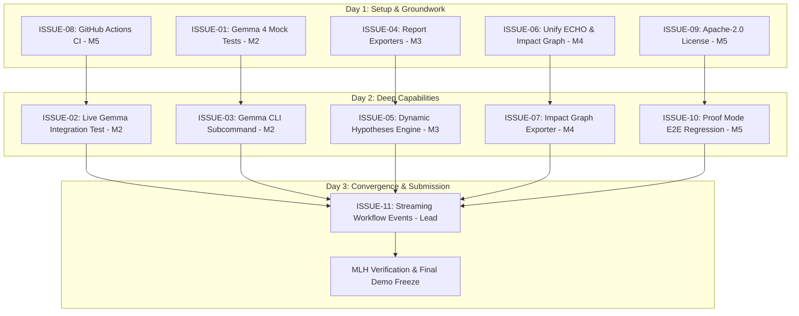

# ANVEXO Pull Request & Team Collaboration Workflow

This document outlines the GitHub contribution rules, code review expectations, PR boundary definitions, and daily coordination rhythms for the five-person ANVEXO engineering team.

---

## 1. Core Workflow Rules

1. **One Issue, One Branch, One PR**: Every pull request corresponds to exactly one issue from [ISSUE_BACKLOG.md](./ISSUE_BACKLOG.md). No sprawling multi-feature PRs.
2. **Branch Naming Standard**:
   - Features: `feat/<member-name>-<short-description>` (e.g., `feat/member2-gemma-unit-tests`)
   - Fixes: `fix/<member-name>-<short-description>` (e.g., `fix/member4-dep-resolution`)
   - Tests & CI: `test/<member-name>-<short-description>` or `ci/<member-name>-github-actions`
3. **No Direct Commits to `main`**: All changes must arrive via pull request with passing CI checks.
4. **Clean Conventional Commits**:
   - `feat(...)`: New user-facing or subsystem capability
   - `fix(...)`: Bug fix or error resolution
   - `test(...)`: Unit, integration, or regression tests
   - `docs(...)`: Documentation additions or revisions
   - `ci(...)`: GitHub Actions or automation updates
5. **No Code Comments Rule**: Preserve ANVEXO codebase standards—do not add code comments (`//`, `/* */`), and keep code self-documenting with descriptive symbol names and strong typing.

---

## 2. Pull Request Boundaries & Ownership Matrix

To prevent merge conflicts and race conditions, each team member is assigned exclusive write access to specific files for their active issues:

```
+---------------------------------------------------------------------------------------+
|                                    SHARED CORE TYPES                                  |
|               (src/core/types.ts - Frozen: Changes require Lead Approval)             |
+---------------------------------------------------------------------------------------+
      |                           |                        |                    |
      v                           v                        v                    v
[Member 2 Zone]           [Member 3 Zone]          [Member 4 Zone]      [Member 5 Zone]
src/providers/gemma.ts    src/engine/index.ts      src/context/         src/proof/
tests/unit/gemma.test.ts  src/reporting/           src/impact/          .github/workflows/
tests/integration/gemma   src/engine/hypotheses.ts tests/unit/impact    LICENSE, package.json
```

### Boundary Table by Issue

| Issue ID | Primary Files Member May Modify | Files Member Must NOT Touch | Validation Command Required |
| :--- | :--- | :--- | :--- |
| **ISSUE-01** (Member 2) | `tests/unit/gemma.test.ts`, `src/providers/gemma.ts` | `src/engine/*`, `src/server/*`, `src/cli/*` | `npx vitest run tests/unit/gemma.test.ts` |
| **ISSUE-02** (Member 2) | `tests/integration/gemma.test.ts`, `package.json` | `src/context/*`, `src/proof/*` | `npm run test:gemma` |
| **ISSUE-03** (Member 2) | `src/cli/index.ts` (Gemma subcommand block only) | `src/engine/workflow.ts`, `src/server/*` | `npx vitest run tests/unit/commands.test.ts` |
| **ISSUE-04** (Member 3) | `src/reporting/index.ts`, `src/reporting/markdown.ts`, `src/engine/index.ts` | `src/providers/*`, `src/impact/*` | `npx vitest run tests/unit/reporting.test.ts` |
| **ISSUE-05** (Member 3) | `src/engine/hypotheses.ts`, `src/engine/index.ts` | `src/context/*`, `src/proof/*` | `npm test` |
| **ISSUE-06** (Member 4) | `src/context/dependencies.ts`, `src/context/manager.ts`, `src/impact/simulator.ts` | `src/providers/*`, `src/reporting/*` | `npx vitest run tests/unit/context.test.ts tests/unit/impact.test.ts` |
| **ISSUE-07** (Member 4) | `src/impact/graph.ts`, `src/impact/types.ts`, `src/cli/index.ts` (impact flags) | `src/engine/*`, `src/server/*` | `npx vitest run tests/unit/impact.test.ts` |
| **ISSUE-08** (Member 5) | `.github/workflows/ci.yml`, `.github/PULL_REQUEST_TEMPLATE.md` | `src/*` | Local YAML validation & CI run |
| **ISSUE-09** (Member 5) | `LICENSE`, `package.json` (license string), `README.md` | `src/*` | `npm run build` |
| **ISSUE-10** (Member 5) | `tests/integration/proof.test.ts`, `src/proof/verifier.ts` | `src/context/*`, `src/providers/*` | `npm test` |
| **ISSUE-11** (Project Lead)| `src/engine/workflow.ts`, `src/server/router.ts`, `src/cli/index.ts` | Submodule internals owned by members | `npx vitest run tests/integration/workflow.test.ts` |

---

## 3. Pull Request Submission Template

Every PR must use the following standard description format (to be formalized in `.github/PULL_REQUEST_TEMPLATE.md` by Member 5):

```markdown
## Summary
Brief 2-3 sentence overview of the technical change.

## Related Issue
Closes #<issue_number>

## Workstream & Component
- Assignee: Member X
- Subsystem: [Gemma 4 | ANVESHAN | ECHO | Proof Mode | CI]

## PR Boundary Compliance
- [ ] Modified only files within designated ownership matrix
- [ ] No changes to frozen shared interfaces without Lead approval
- [ ] Zero comments added in code (adhering to project code style)

## Verification Evidence
- Commands executed:
  \`\`\`bash
  npm run build
  npx vitest run <test_file>
  \`\`\`
- Output:
  \`\`\`text
  <paste test runner summary>
  \`\`\`

## Proof Mode Status
- Status: [VERIFIED | PARTIAL | UNVERIFIED]
- Dynamic executions: <count>
- Static inspections: <count>
```

---

## 4. Peer Review Matrix

To maintain high code quality and spread codebase knowledge, every PR requires:
1. **One Peer Review** from a designated peer reviewer.
2. **Final Architecture Approval** from the Project Lead.

| Author | Primary Peer Reviewer | Secondary Peer Reviewer | Final Architecture Sign-off |
| :--- | :--- | :--- | :--- |
| **Member 2** (Gemma 4) | Member 3 (ANVESHAN) | Member 5 (Proof/CI) | Project Lead |
| **Member 3** (ANVESHAN) | Member 2 (Gemma 4) | Member 4 (ECHO) | Project Lead |
| **Member 4** (ECHO/Impact) | Member 5 (Proof/CI) | Member 3 (ANVESHAN) | Project Lead |
| **Member 5** (Proof/CI) | Member 4 (ECHO/Impact) | Member 2 (Gemma 4) | Project Lead |
| **Project Lead** | Member 2 | Member 3 | Peer Consensus |

---

## 5. Parallel Execution Sequence & Dependency Graph



---

## 6. Daily Coordination Rhythm

To ensure momentum without meeting fatigue, the team follows a 3-point asynchronous daily check-in:

### Daily Standup Format (Slack / Discord / GitHub Discussions)
1. **Yesterday**: What PR or tests did I complete?
2. **Today**: Which backlog issue branch am I implementing?
3. **Blockers / Dependencies**: Do I need a review or an interface sign-off from another member?

### Pre-Merge Checklist
- [ ] `npm run lint` passes without TypeScript errors (`tsc --noEmit`).
- [ ] `npm run build` generates clean artifacts in `dist/`.
- [ ] `npm test` runs all 26 test files with 100% pass rate.
- [ ] Peer review approved by assigned partner.
- [ ] Lead approved and merged via GitHub PR.
